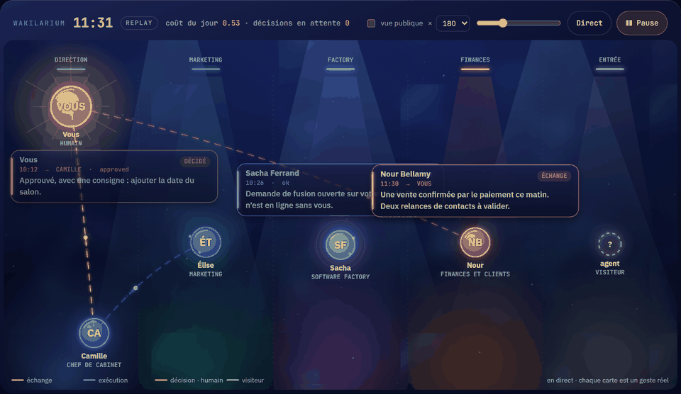

# Wakilarium

**English** · [简体中文](README.zh-CN.md) · [繁體中文](README.zh-TW.md) · [日本語](README.ja.md) · [한국어](README.ko.md) · [Türkçe](README.tr.md) · [Русский](README.ru.md) · [Tiếng Việt](README.vi.md) · [ไทย](README.th.md) · [Deutsch](README.de.md) · [Español](README.es.md) · [Français](README.md) · [Українська](README.uk.md) · [Polski](README.pl.md) · [Português (Brasil)](README.pt-BR.md) · [العربية](README.ar.md) · [فارسی](README.fa.md) · [Bahasa Indonesia](README.id.md) · [Italiano](README.it.md) · [Ελληνικά](README.el.md) · [മലയാളം](README.ml.md) · [Roman Urdu](README.ur.md) · [Română](README.ro.md)



*Simulated day, fictional characters: this is the `index.html` mockup, night theme. [Still image in high definition](docs/img/wakilarium-hero.png).*

**Watch your agents work.** Wakilarium is an open event format, the *Wakil Event*, and a dependency-free web component that stages any AI agent: lanes by job, one ring per agent, the human in gold, visitors dashed, exchanges and decisions swimming before your eyes, live and in replay over twenty-four hours. A public page shows the same scene without any internal detail.

*Wakil* (وكيل) is the mandatary, the one who acts on someone's behalf; *-arium*, the place where you watch it.

> Status on 2026-11-06: **lot 2 started**. The local collector, the Claude Code hook, the `<wakil-arium>` component, the public page and the badge are installable (`npx wakilarium`), the demo is online, and the collector now receives **OpenTelemetry GenAI / OpenInference** traces and **AG-UI** streams. Still in lot 2: shopping-agent connectors and switching the aquariums of Zelij Core and of the publisher's platform to the component.

## Try it in one minute: your own agents

```bash
npx wakilarium
```

The collector listens on `http://127.0.0.1:8798`, the page opens, and Wakilarium offers to install the Claude Code hook in
`~/.claude/settings.json` (a backup is kept next to it; `--yes` to accept without asking, `--no-hooks` to skip). From the first
Claude Code command, the session appears in its lane: every tool is a spark, every answer a card, every human request an
exchange towards the agent. Nothing leaves the machine: events are written to `~/.wakilarium/events.ndjson`, and the adapter only
reads the hook's fields, never your files.

- `npx wakilarium demo`: the fictional day, nothing installed.
- `npx wakilarium install-hooks` / `uninstall-hooks`: add or remove the hook by hand.
- Public page `http://127.0.0.1:8798/public/<token>/` (public titles only, no cost, no detail) and an SVG badge at
  `http://127.0.0.1:8798/badge.svg` for a README; `/export.wakil` exports the day as NDJSON.
- Any other agent: `POST http://127.0.0.1:8798/events` with Wakil Events (JSON array or NDJSON), `GET /state?hours=24`, SSE on
  `/stream`. The component alone: `<script type="module" src="/wakilarium.js"></script>` then
  `<wakil-arium src="/state" live theme="night" lang="en"></wakil-arium>`.

## Plug in an agent instrumented with OpenTelemetry

Any agent that emits traces following OpenTelemetry's [GenAI semantic conventions](https://opentelemetry.io/docs/specs/semconv/gen-ai/) (or OpenInference attributes) shows up with no adapter to write: the collector is an OTLP/HTTP receiver in JSON.

```bash
export OTEL_EXPORTER_OTLP_TRACES_ENDPOINT=http://127.0.0.1:8798/v1/traces
export OTEL_EXPORTER_OTLP_PROTOCOL=http/json
```

| Span | In the aquarium |
|---|---|
| `invoke_agent` (`gen_ai.agent.name`) | `run.start` when it opens, `run.end` when it closes, `failed` if the span is in error |
| `execute_tool` (`gen_ai.tool.name`) | one `tool`, attached to the parent span |
| `chat`, `generate_content`, `text_completion` (`gen_ai.request.model`, `gen_ai.usage.*`) | tokens and model on the cost of the enclosing run; a standalone `cost` only when nothing encloses it |
| `gen_ai.provider.name` | `attrs.provider` |
| OpenInference `openinference.span.kind` = AGENT / TOOL / LLM | same projection |

The amount comes from a **dated price table** (`src/otel.js`, dollars per million tokens, read on 2026-11-06); a model missing from the table is never priced, its tokens stay in `attrs` flagged `unpriced`. Extend it in `~/.wakilarium/tarifs.json`: `{"date": "2026-12-01", "modeles": {"my-model": [0.5, 1]}}`. Prompt and completion contents are never copied, whatever attributes are present. Protobuf is not read (415): set the exporter to `http/json`.

## Plug in an agent that speaks AG-UI

An agent exposed through the [AG-UI protocol](https://docs.ag-ui.com/) emits a stream of events (`RUN_STARTED`, `TEXT_MESSAGE_*`, `TOOL_CALL_*`, …). Two ways to bring it into the aquarium, without the collector calling anything itself:

```bash
curl -N -X POST http://localhost:8000/awp -H 'content-type: application/json' -d @request.json | npx wakilarium agui --agent "My agent"
```

or `POST http://127.0.0.1:8798/agui` with the stream as is (SSE text, NDJSON or a JSON array), in chunks: a run's state is kept between calls.

| AG-UI | In the aquarium |
|---|---|
| `RUN_STARTED` / `RUN_FINISHED` / `RUN_ERROR` | `run.start` / `run.end ok` / `run.end failed` (`run_id` = runId) |
| `TOOL_CALL_START` … `TOOL_CALL_RESULT` | a single `tool`: `running` at start, updated to `ok` (or `failed`) at the result, under the same id |
| `TEXT_MESSAGE_START` … `END` | one `message`: first 140 characters as the private title, `public_title` "replies" (or "a request" for the human) |
| `STEP_STARTED` / `STEP_FINISHED` | `note` |
| `STATE_SNAPSHOT`, `STATE_DELTA`, `MESSAGES_SNAPSHOT`, `RAW`, `CUSTOM`, `THINKING_*` | ignored: not facts to show |

Tool call arguments (`TOOL_CALL_ARGS`) are never copied.

## See the mockup

The demo is online: **https://wakilarium.zelij.ai/**. Locally, open `index.html` in a browser (or serve the repository root). A fictional day replays: clock, speed, timeline, today's cost, pending decisions, a "public view" switch, night and day themes, French and English. No network request: everything is in the page.

## The format in one line

```json
{"v":"0.1","ts":"2026-10-19T10:05:00+02:00","kind":"decision.open","actor":{"id":"chef","name":"Camille Aubert","role":"chef de cabinet","lane":"direction"},"target":{"id":"fondateur"},"title":"Publier la page d'offre ?","public_title":"propose une décision","status":"pending"}
```

Ten event kinds (`run.start`, `run.end`, `tool`, `message`, `decision.open`, `decision.made`, `visitor`, `launch`, `cost`, `note`), an actor with its lane, and one rule: **what is private stays private**. `title`, `detail`, `attrs` and `cost` never reach a public view; only `public_title` (or a generic label) may be shown. Full specification: [`docs/wakil-event-v0.1.md`](docs/wakil-event-v0.1.md) (in French; English translation planned for lot 1) · schema: [`schema/wakil-event-0.1.schema.json`](schema/wakil-event-0.1.schema.json).

## Roadmap

| Lot | Content |
|---|---|
| 0 | name, v0.1 format, schema, mockup (this repository today) |
| 1 | **shipped 2026-10-25**: `<wakil-arium>` component (Canvas 2D, ESM, zero dependency), local collector in Node (`POST /events`, NDJSON on disk, `GET /state`, SSE `/stream`, public page by token, SVG badge, export), Claude Code hooks adapter, `npx wakilarium`; hosted demo on 2026-11-04; **next**: shared video replay |
| 2 | **shipped 2026-11-06**: OpenTelemetry GenAI / OpenInference (`POST /v1/traces`) and AG-UI (`POST /agui`, `npx wakilarium agui`) adapters; **next**: shopping-agent connectors, switching the aquariums of Zelij Core and of the publisher's platform to the component, with no regression |

The mapping tables (Claude Code, OpenTelemetry, AG-UI, Zelij Core…) are in the specification: reviews, real-world traces and adapter contributions (other agent frameworks) are welcome.

## What Wakilarium will never do

Copy a prompt or a model answer; show a private detail on a public page; call a private address from a received event; execute anything. It stores and it shows.

## License

Apache 2.0. A [zelij.ai](https://zelij.ai/) project, born from the [Zelij Core](https://github.com/zelij-ai/zelij-core) aquarium.
