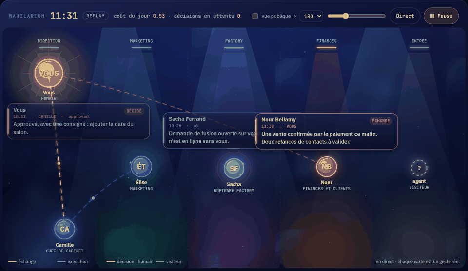

# Wakilarium

[English](README.en.md) · [简体中文](README.zh-CN.md) · [繁體中文](README.zh-TW.md) · [日本語](README.ja.md) · [한국어](README.ko.md) · [Türkçe](README.tr.md) · [Русский](README.ru.md) · [Tiếng Việt](README.vi.md) · [ไทย](README.th.md) · [Deutsch](README.de.md) · [Español](README.es.md) · **Français** · [Українська](README.uk.md) · [Polski](README.pl.md) · [Português (Brasil)](README.pt-BR.md) · [العربية](README.ar.md) · [فارسی](README.fa.md) · [Bahasa Indonesia](README.id.md) · [Italiano](README.it.md) · [Ελληνικά](README.el.md) · [മലയാളം](README.ml.md) · [Roman Urdu](README.ur.md) · [Română](README.ro.md)



*Journée simulée, personnages fictifs : c'est la maquette `index.html`, thème nuit. [Image fixe en haute définition](docs/img/wakilarium-hero.png).*

**Regardez vos agents travailler.** Wakilarium est un format d'événement ouvert, le *Wakil Event*, et un composant web sans dépendance qui met en scène n'importe quel agent d'IA : couloirs par métier, un anneau par agent, l'humain en or, les visiteurs en pointillé, les échanges et les décisions qui nagent sous vos yeux, en direct et en replay sur vingt-quatre heures. Une page publique montre la même scène sans aucun détail interne.

« Wakil » (وكيل) est le mandataire, celui qui agit au nom d'un autre ; « -arium », le lieu où on l'observe.

> État au 06/11/2026 : **lot 2 commencé**. Le collecteur local, le hook Claude Code, le composant `<wakil-arium>`, la page publique et le badge sont installables (`npx wakilarium`), la démo est en ligne, et le collecteur reçoit désormais les traces **OpenTelemetry GenAI / OpenInference** et les flux **AG-UI**. Restent au lot 2 : les connecteurs d'agents d'achat et la bascule des aquariums de Zelij Core et de la plateforme de l'éditeur.

## Essayer en une minute : vos propres agents

```bash
npx wakilarium
```

Le collecteur écoute sur `http://127.0.0.1:8798`, la page s'ouvre, et Wakilarium propose d'installer le hook Claude Code dans
`~/.claude/settings.json` (une sauvegarde est faite à côté ; `--yes` pour accepter sans question, `--no-hooks` pour s'en passer).
Dès la première commande de Claude Code, la session apparaît dans son couloir : chaque outil est une étincelle, chaque réponse
une carte, chaque demande de l'humain un échange vers l'agent. Rien ne quitte la machine : les événements sont écrits dans
`~/.wakilarium/events.ndjson`, l'adaptateur ne lit que les champs du hook, jamais vos fichiers.

- `npx wakilarium demo` : la journée fictive, sans rien installer.
- `npx wakilarium install-hooks` / `uninstall-hooks` : poser ou retirer le hook à la main.
- Page publique `http://127.0.0.1:8798/public/<jeton>/` (titres publics seulement, sans coût ni détail) et badge SVG
  `http://127.0.0.1:8798/badge.svg` pour un README ; `/export.wakil` exporte la journée en NDJSON.
- Pour tout autre agent : `POST http://127.0.0.1:8798/events` avec des Wakil Events (tableau JSON ou NDJSON), `GET /state?hours=24`,
  flux SSE sur `/stream`. Le composant seul : `<script type="module" src="/wakilarium.js"></script>` puis
  `<wakil-arium src="/state" live theme="night" lang="fr"></wakil-arium>`.

## Brancher un agent instrumenté en OpenTelemetry

Tout agent qui émet des traces selon les [conventions sémantiques GenAI](https://opentelemetry.io/docs/specs/semconv/gen-ai/) d'OpenTelemetry (ou les attributs OpenInference) se met en scène sans adaptateur à écrire : le collecteur est un récepteur OTLP/HTTP en JSON.

```bash
export OTEL_EXPORTER_OTLP_TRACES_ENDPOINT=http://127.0.0.1:8798/v1/traces
export OTEL_EXPORTER_OTLP_PROTOCOL=http/json
```

| Span | Dans l'aquarium |
|---|---|
| `invoke_agent` (`gen_ai.agent.name`) | `run.start` à l'ouverture, `run.end` à la fermeture, `failed` si le span est en erreur |
| `execute_tool` (`gen_ai.tool.name`) | un `tool`, rattaché au span parent |
| `chat`, `generate_content`, `text_completion` (`gen_ai.request.model`, `gen_ai.usage.*`) | les jetons et le modèle sur le coût de l'exécution qui l'englobe ; seul un `cost` si aucune ne l'englobe |
| `gen_ai.provider.name` | `attrs.provider` |
| OpenInference `openinference.span.kind` = AGENT / TOOL / LLM | même projection |

Le montant vient d'une **table de tarifs datée** (`src/otel.js`, dollars par million de jetons, relevée le 06/11/2026) ; un modèle absent de la table n'est jamais chiffré, ses jetons restent dans `attrs` avec la mention `unpriced`. Complétez-la dans `~/.wakilarium/tarifs.json` : `{"date": "2026-12-01", "modeles": {"mon-modele": [0.5, 1]}}`. Les contenus des prompts et des réponses ne sont jamais copiés, quels que soient les attributs présents. Le protobuf n'est pas lu (réponse 415) : réglez l'exportateur en `http/json`.

## Brancher un agent qui parle AG-UI

Un agent exposé selon le [protocole AG-UI](https://docs.ag-ui.com/) émet un flux d'événements (`RUN_STARTED`, `TEXT_MESSAGE_*`, `TOOL_CALL_*`, …). Deux façons de l'amener dans l'aquarium, sans que le collecteur appelle quoi que ce soit lui-même :

```bash
curl -N -X POST http://localhost:8000/awp -H 'content-type: application/json' -d @requete.json | npx wakilarium agui --agent "Mon agent"
```

ou `POST http://127.0.0.1:8798/agui` avec le flux tel quel (texte SSE, NDJSON ou tableau JSON), par morceaux : l'état d'une exécution est gardé entre les appels.

| AG-UI | Dans l'aquarium |
|---|---|
| `RUN_STARTED` / `RUN_FINISHED` / `RUN_ERROR` | `run.start` / `run.end ok` / `run.end failed` (`run_id` = runId) |
| `TOOL_CALL_START` … `TOOL_CALL_RESULT` | un seul `tool`, `running` au départ, mis à jour `ok` (ou `failed`) au résultat, sous le même identifiant |
| `TEXT_MESSAGE_START` … `END` | un `message` : 140 premiers caractères en titre privé, `public_title` « répond » (ou « une demande » pour l'humain) |
| `STEP_STARTED` / `STEP_FINISHED` | `note` |
| `STATE_SNAPSHOT`, `STATE_DELTA`, `MESSAGES_SNAPSHOT`, `RAW`, `CUSTOM`, `THINKING_*` | ignorés : ce ne sont pas des faits à montrer |

Les arguments des appels d'outils (`TOOL_CALL_ARGS`) ne sont jamais copiés.

## Voir la maquette

La démo est en ligne : **https://wakilarium.zelij.ai/**. En local, ouvrez `index.html` dans un navigateur (ou servez la racine du dépôt). Une journée fictive se rejoue : horloge, vitesse, ligne de temps, coût du jour, décisions en attente, case « vue publique », thèmes nuit et jour, français et anglais. Aucune requête réseau : tout est dans la page.

## Le format en une ligne

```json
{"v":"0.1","ts":"2026-10-19T10:05:00+02:00","kind":"decision.open","actor":{"id":"chef","name":"Camille Aubert","role":"chef de cabinet","lane":"direction"},"target":{"id":"fondateur"},"title":"Publier la page d'offre ?","public_title":"propose une décision","status":"pending"}
```

Dix natures d'événement (`run.start`, `run.end`, `tool`, `message`, `decision.open`, `decision.made`, `visitor`, `launch`, `cost`, `note`), un acteur avec son couloir, et une règle : **ce qui est privé le reste**. `title`, `detail`, `attrs` et `cost` ne sortent jamais sur une vue publique ; seul `public_title` (ou un libellé générique) peut s'afficher. Spécification complète : [`docs/wakil-event-v0.1.md`](docs/wakil-event-v0.1.md) · schéma : [`schema/wakil-event-0.1.schema.json`](schema/wakil-event-0.1.schema.json).

## Ce qui est prévu

| Lot | Contenu |
|---|---|
| 0 | nom, format v0.1, schéma, maquette (ce dépôt aujourd'hui) |
| 1 | **livré le 25/10** : composant `<wakil-arium>` (Canvas 2D, ESM, zéro dépendance), collecteur local en Node (`POST /events`, NDJSON sur disque, `GET /state`, `/stream` SSE, page publique par jeton, badge SVG, export), adaptateur hooks Claude Code, `npx wakilarium` ; démo hébergée le 04/11 ; **à venir** : replay partagé en vidéo |
| 2 | **livrés le 06/11** : adaptateurs OpenTelemetry GenAI / OpenInference (`POST /v1/traces`) et AG-UI (`POST /agui`, `npx wakilarium agui`) ; **à venir** : connecteurs d'agents d'achat, bascule des aquariums de Zelij Core et de la plateforme de l'éditeur, sans régression |

Les tables de correspondance (Claude Code, OpenTelemetry, AG-UI, Zelij Core…) sont dans la spécification : relectures, cas réels de traces et contributions d'adaptateurs (autres cadres d'agents) sont bienvenus.

## Ce que Wakilarium ne fera jamais

Copier le contenu d'un prompt ou d'une réponse ; afficher un détail privé sur une page publique ; appeler une adresse privée depuis un événement reçu ; exécuter quoi que ce soit. Il range et il montre.

## Licence

Apache 2.0. Un projet de [zelij.ai](https://zelij.ai/), né de l'aquarium de [Zelij Core](https://github.com/zelij-ai/zelij-core).
