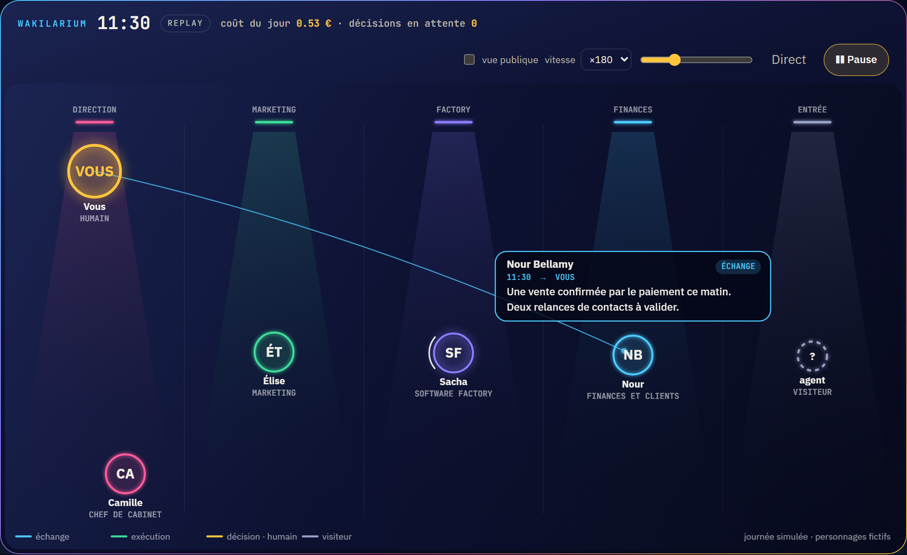

# Wakilarium

**Français** · [English](#english)


*Journée simulée, personnages fictifs : c'est la maquette `demo/index.html`, thème nuit. [Image fixe en haute définition](docs/img/wakilarium-hero.png).*

**Regardez vos agents travailler.** Wakilarium est un format d'événement ouvert, le *Wakil Event*, et un composant web sans dépendance qui met en scène n'importe quel agent d'IA : couloirs par métier, un anneau par agent, l'humain en or, les visiteurs en pointillé, les échanges et les décisions qui nagent sous vos yeux, en direct et en replay sur vingt-quatre heures. Une page publique montre la même scène sans aucun détail interne.

« Wakil » (وكيل) est le mandataire, celui qui agit au nom d'un autre ; « -arium », le lieu où on l'observe.

> État au 19/10/2026 : **lot 0**. Le format v0.1, son schéma et une maquette interactive sont publiés ici pour relecture. Le composant, le collecteur et les adaptateurs arrivent au lot 1. Rien n'est encore installable.

## Voir la maquette

Ouvrez `demo/index.html` dans un navigateur (ou servez le dossier `demo/`). Une journée fictive se rejoue : horloge, vitesse, ligne de temps, coût du jour, décisions en attente, case « vue publique », thèmes nuit et jour, français et anglais. Aucune requête réseau : tout est dans la page.

## Le format en une ligne

```json
{"v":"0.1","ts":"2026-10-19T10:05:00+02:00","kind":"decision.open","actor":{"id":"chef","name":"Camille Aubert","role":"chef de cabinet","lane":"direction"},"target":{"id":"fondateur"},"title":"Publier la page d'offre ?","public_title":"propose une décision","status":"pending"}
```

Dix natures d'événement (`run.start`, `run.end`, `tool`, `message`, `decision.open`, `decision.made`, `visitor`, `launch`, `cost`, `note`), un acteur avec son couloir, et une règle : **ce qui est privé le reste**. `title`, `detail`, `attrs` et `cost` ne sortent jamais sur une vue publique ; seul `public_title` (ou un libellé générique) peut s'afficher. Spécification complète : [`docs/wakil-event-v0.1.md`](docs/wakil-event-v0.1.md) · schéma : [`schema/wakil-event-0.1.schema.json`](schema/wakil-event-0.1.schema.json).

## Ce qui est prévu

| Lot | Contenu |
|---|---|
| 0 | nom, format v0.1, schéma, maquette (ce dépôt aujourd'hui) |
| 1 | composant `<wakil-arium>` (Canvas 2D, ESM + IIFE, npm et CDN), collecteur `wakil-collect` (Python : `POST /events`, suivi de fichier, OTLP/HTTP, SQLite, `GET /state`, page publique par jeton, `demo`), adaptateur hooks Claude Code, démo hébergée |
| 2 | adaptateurs OpenTelemetry GenAI / OpenInference, AG-UI, connecteurs d'agents d'achat ; bascule des aquariums de Zelij Core et de la plateforme de l'éditeur, sans régression |

Les tables de correspondance (Claude Code, OpenTelemetry, AG-UI, Zelij Core…) sont déjà dans la spécification : les relectures et contributions d'adaptateurs sont bienvenues avant le code.

## Ce que Wakilarium ne fera jamais

Copier le contenu d'un prompt ou d'une réponse ; afficher un détail privé sur une page publique ; appeler une adresse privée depuis un événement reçu ; exécuter quoi que ce soit. Il range et il montre.

## Licence

Apache 2.0. Un projet de [zelij.ai](https://zelij.ai/), né de l'aquarium de [Zelij Core](https://github.com/zelij-ai/zelij-core).

---

## English



*Simulated day, fictional characters: this is the `demo/index.html` mockup, night theme.*

**Watch your agents work.** Wakilarium is an open event format, the *Wakil Event*, and a dependency-free web component that stages any AI agent: lanes by job, one ring per agent, the human in gold, visitors dashed, exchanges and decisions swimming before your eyes, live and in replay over twenty-four hours. A public page shows the same scene without any internal detail.

*Wakil* (وكيل) is the mandatary, the one who acts on someone's behalf; *-arium*, the place where you watch it.

> Status on 2026-10-19: **lot 0**. The v0.1 format, its schema and an interactive mockup are published here for review. The component, the collector and the adapters come with lot 1. Nothing is installable yet.

**See the mockup**: open `demo/index.html` in a browser (or serve the `demo/` folder). A fictional day replays: clock, speed, timeline, today's cost, pending decisions, a "public view" switch, night and day themes, French and English. No network request: everything is in the page.

**The format**: ten event kinds, an actor with its lane, and one rule: what is private stays private. `title`, `detail`, `attrs` and `cost` never reach a public view; only `public_title` (or a generic label) may be shown. Full specification: [`docs/wakil-event-v0.1.md`](docs/wakil-event-v0.1.md) (French; English translation planned for lot 1) · schema: [`schema/wakil-event-0.1.schema.json`](schema/wakil-event-0.1.schema.json).

**Roadmap**: lot 1 ships the `<wakil-arium>` component (Canvas 2D, ESM + IIFE, npm and CDN), the `wakil-collect` collector (Python: `POST /events`, file tail, OTLP/HTTP, SQLite, `GET /state`, public page by token, `demo`), a Claude Code hooks adapter and a hosted demo; lot 2 adds OpenTelemetry GenAI / OpenInference, AG-UI and shopping-agent connectors, and switches the Zelij Core aquarium to the component with no regression.

**What Wakilarium will never do**: copy a prompt or a model answer; show a private detail on a public page; call a private address from a received event; execute anything. It stores and it shows.

**License**: Apache 2.0. A [zelij.ai](https://zelij.ai/) project, born from the [Zelij Core](https://github.com/zelij-ai/zelij-core) aquarium.
