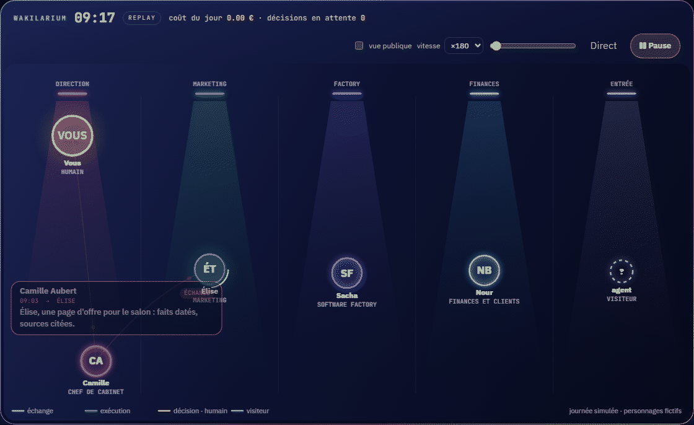

# Wakilarium

[English](README.en.md) · [简体中文](README.zh-CN.md) · [繁體中文](README.zh-TW.md) · [日本語](README.ja.md) · [한국어](README.ko.md) · [Türkçe](README.tr.md) · [Русский](README.ru.md) · **Tiếng Việt** · [ไทย](README.th.md) · [Deutsch](README.de.md) · [Español](README.es.md) · [Français](README.md) · [Українська](README.uk.md) · [Polski](README.pl.md) · [Português (Brasil)](README.pt-BR.md) · [العربية](README.ar.md) · [فارسی](README.fa.md) · [Bahasa Indonesia](README.id.md) · [Italiano](README.it.md) · [Ελληνικά](README.el.md) · [മലയാളം](README.ml.md) · [Roman Urdu](README.ur.md) · [Română](README.ro.md)



*Một ngày mô phỏng, nhân vật hư cấu: đây là bản mẫu `demo/index.html`, chủ đề ban đêm. [Ảnh tĩnh độ phân giải cao](docs/img/wakilarium-hero.png).*

**Hãy xem các tác nhân của bạn làm việc.** Wakilarium là một định dạng sự kiện mở, *Wakil Event*, và một web component không phụ thuộc, đưa bất kỳ tác nhân AI nào lên sân khấu: làn theo nghề, mỗi tác nhân một vòng, con người màu vàng, khách ghé thăm nét đứt, các trao đổi và quyết định bơi trước mắt bạn, trực tiếp và phát lại trong hai mươi bốn giờ. Một trang công khai cho thấy cùng khung cảnh mà không có bất kỳ chi tiết nội bộ nào.

« Wakil » (وكيل) là người được ủy quyền, người hành động thay cho người khác; « -arium » là nơi ta quan sát họ.

> Tình trạng ngày 19/10/2026: **lô 0**. Định dạng v0.1, lược đồ của nó và một bản mẫu tương tác được công bố tại đây để góp ý. Component, bộ thu thập và các bộ chuyển đổi sẽ đến ở lô 1. Chưa có gì cài đặt được.

## Xem bản mẫu

Mở `demo/index.html` trong trình duyệt (hoặc phục vụ thư mục `demo/`). Một ngày hư cấu được phát lại: đồng hồ, tốc độ, dòng thời gian, chi phí trong ngày, các quyết định đang chờ, nút « chế độ công khai », chủ đề đêm và ngày, tiếng Pháp và tiếng Anh. Không có yêu cầu mạng nào: mọi thứ nằm trong trang.

## Định dạng trong một dòng

```json
{"v":"0.1","ts":"2026-10-19T10:05:00+02:00","kind":"decision.open","actor":{"id":"chef","name":"Camille Aubert","role":"chef de cabinet","lane":"direction"},"target":{"id":"fondateur"},"title":"Publier la page d'offre ?","public_title":"propose une décision","status":"pending"}
```

Mười loại sự kiện (`run.start`, `run.end`, `tool`, `message`, `decision.open`, `decision.made`, `visitor`, `launch`, `cost`, `note`), một tác nhân với làn của mình, và một quy tắc: **những gì riêng tư thì vẫn riêng tư**. `title`, `detail`, `attrs` và `cost` không bao giờ xuất hiện trên chế độ công khai; chỉ `public_title` (hoặc một nhãn chung) có thể hiển thị. Đặc tả đầy đủ: [`docs/wakil-event-v0.1.md`](docs/wakil-event-v0.1.md) (tiếng Pháp) · lược đồ: [`schema/wakil-event-0.1.schema.json`](schema/wakil-event-0.1.schema.json).

## Lộ trình

| Lô | Nội dung |
|---|---|
| 0 | tên, định dạng v0.1, lược đồ, bản mẫu (kho này hôm nay) |
| 1 | component `<wakil-arium>` (Canvas 2D, ESM + IIFE, npm và CDN), bộ thu thập `wakil-collect` (Python: `POST /events`, theo dõi tệp, OTLP/HTTP, SQLite, `GET /state`, trang công khai theo mã thông báo, `demo`), bộ chuyển đổi hook Claude Code, bản demo được lưu trữ |
| 2 | bộ chuyển đổi OpenTelemetry GenAI / OpenInference, AG-UI, kết nối tác nhân mua sắm; chuyển các bể cá của Zelij Core và của nền tảng nhà phát hành sang component, không hồi quy |

Các bảng ánh xạ (Claude Code, OpenTelemetry, AG-UI, Zelij Core…) đã có trong đặc tả: hoan nghênh góp ý và đóng góp bộ chuyển đổi trước khi viết mã.

## Những gì Wakilarium sẽ không bao giờ làm

Sao chép nội dung của một prompt hay một câu trả lời của mô hình; hiển thị chi tiết riêng tư trên trang công khai; gọi đến địa chỉ riêng từ một sự kiện nhận được; thực thi bất cứ thứ gì. Nó cất giữ và nó trưng bày.

## Giấy phép

Apache 2.0. Một dự án của [zelij.ai](https://zelij.ai/), sinh ra từ bể cá của [Zelij Core](https://github.com/zelij-ai/zelij-core).
